# docu.md Diagram Reference

Source: [docu.md](https://docu.md) / [markdown-viewer-extension](https://github.com/markdown-viewer/markdown-viewer-extension) (GPL-3.0, v5.1.0)

docu.md bridges the gap between AI-generated Markdown and finished deliverables. Its core thesis aligns with this skill's Dual Reader architecture: the agent produces `.md` (source layer), docu.md renders it into DOCX/PDF/HTML (human reader layer).

## Supported Diagram Engines

docu.md renders 7 diagram engines from fenced code blocks. No configuration needed — write the diagram code in Markdown, docu.md renders it live.

| Engine | Code block language | File extensions | Best for |
|---|---|---|---|
| Mermaid | `mermaid` | `.mermaid`, `.mmd` | Flowcharts, sequence, gantt, class, state, pie, ER, git graph, mindmap, timeline, quadrant, sankey, xychart, kanban, architecture, radar, treemap, packet |
| PlantUML | `plantuml`, `puml`, `wsd` | `.plantuml`, `.puml` | UML class, sequence, activity, state, use case, deployment, object diagrams |
| Vega-Lite | `vega-lite`, `vegalite` | `.vl`, `.vega-lite` | Declarative statistical charts (bar, scatter, line, area, stacked, grouped) |
| Vega | `vega` | `.vega` | Low-level visualization grammar, complex interactive charts |
| Graphviz DOT | `dot`, `graphviz` | `.gv`, `.dot` | Directed/undirected graphs, network topology, architecture diagrams |
| drawio | `drawio` | `.drawio` | Diagram.net style diagrams |
| Infographic | `infographic` | `.infographic` | @antv/infographic charts |
| Canvas | `canvas` | `.canvas` | JSON Canvas format (Obsidian compatible) |

Plus: LaTeX math formulas (via KaTeX/MathJax), 100+ language syntax highlighting.

## Work-flow Alignment with Dual Reader Architecture

```text
agent produces .md (source layer, source of truth)
  → docu.md renders to .docx / .pdf / .html (human reader layer)
  → diagrams rendered as high-resolution images
  → LaTeX rendered as editable Word equations (DOCX) or KaTeX (HTML)
```

Rules:
- The `.md` file is the agent source layer. Fix claims there first.
- docu.md output is the human reader layer, regenerated from source.
- Never hand-edit docu.md output to override source truth.
- Keep `.md` and exported `.docx`/`.pdf`/`.html` as sibling files.

## Mermaid Quick Templates

### Flowchart

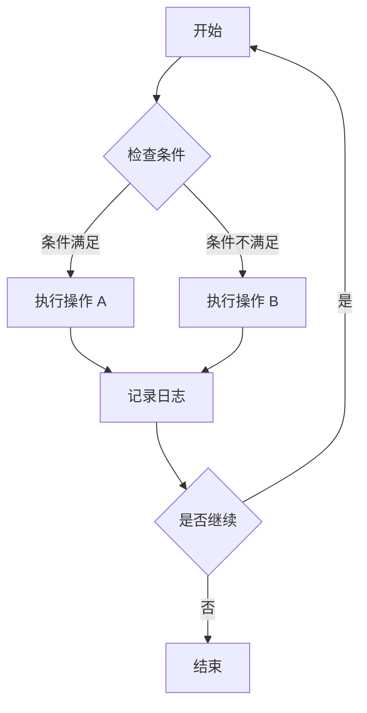

### Sequence Diagram

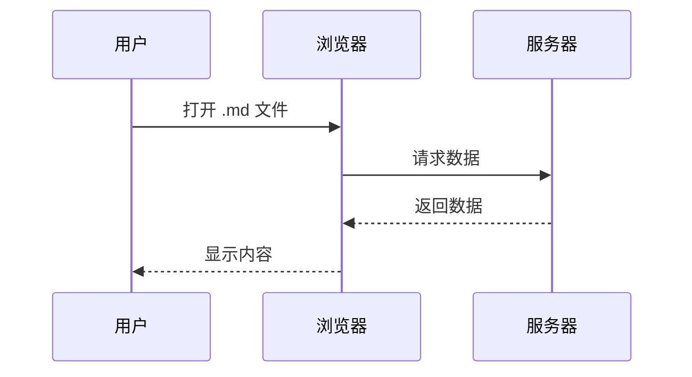

### Gantt Chart

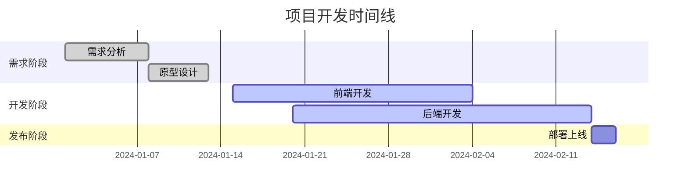

### State Diagram

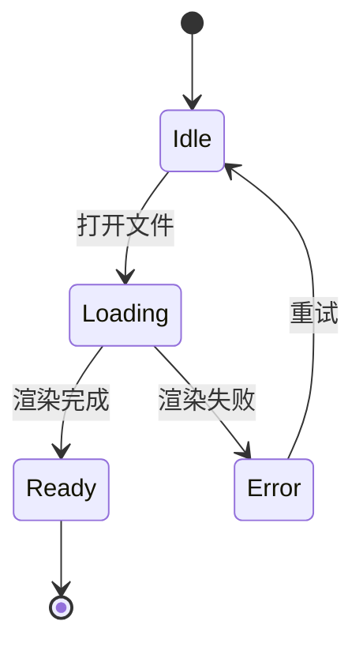

### ER Diagram

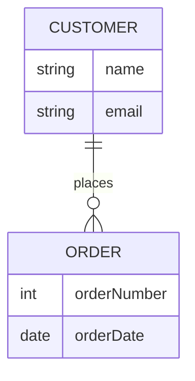

### Architecture Diagram

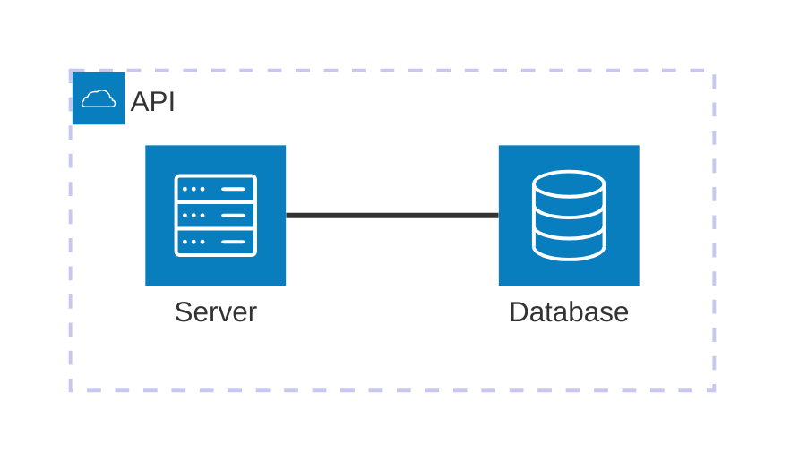

### Data Flow (custom graph)

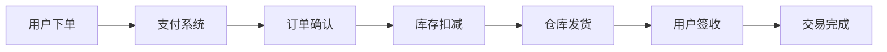

### Comparison (subgraph)

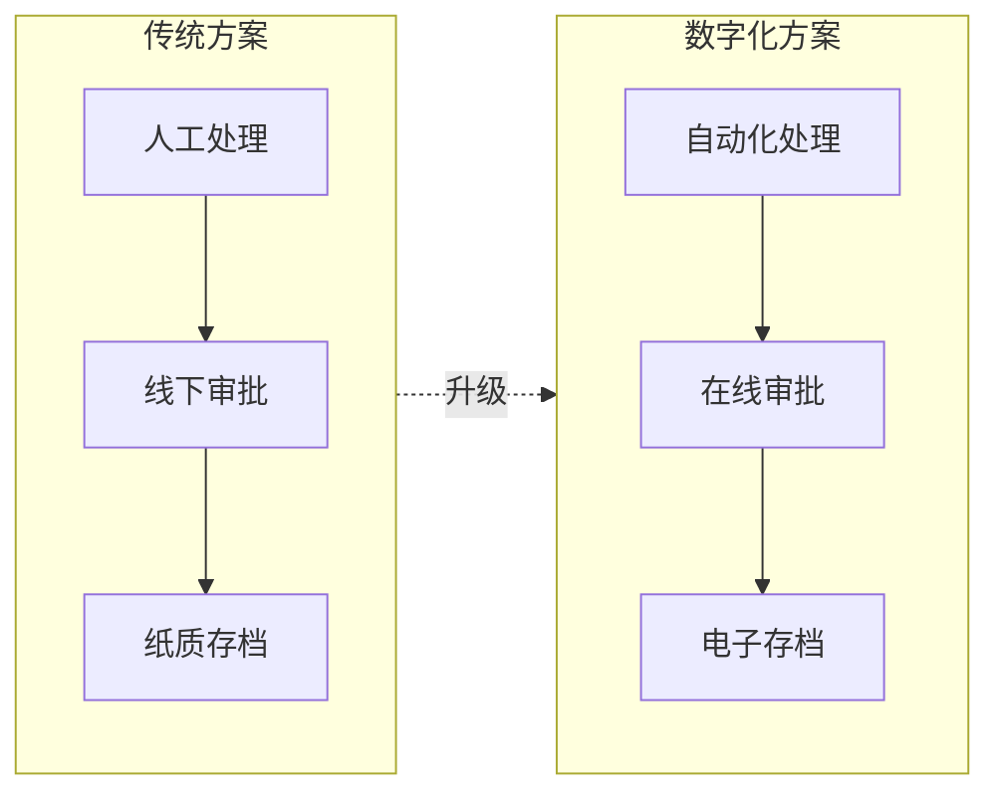

## PlantUML Quick Templates

### Class Diagram

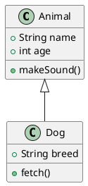

### Sequence Diagram

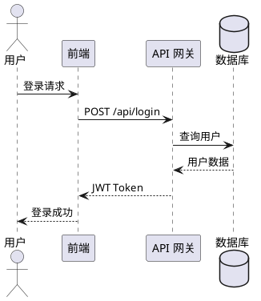

### Activity Diagram (with swimlanes)

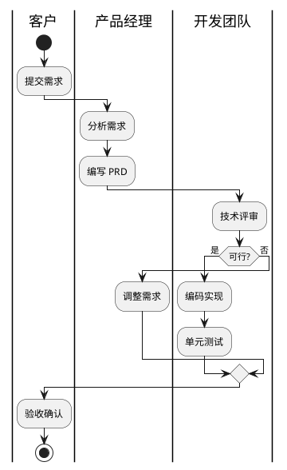

### Deployment Diagram

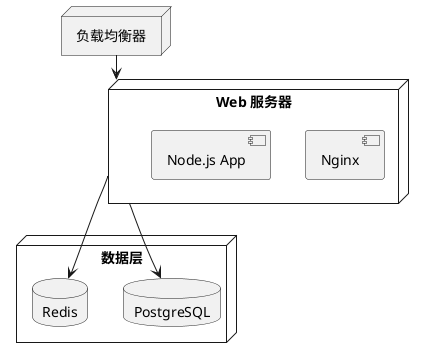

## Vega-Lite Quick Template

### Bar Chart

```vega-lite
{
  "$schema": "https://vega.github.io/schema/vega-lite/v5.json",
  "description": "A simple bar chart with embedded data.",
  "data": {
    "values": [
      {"category": "A", "value": 28},
      {"category": "B", "value": 55},
      {"category": "C", "value": 43}
    ]
  },
  "mark": "bar",
  "encoding": {
    "x": {"field": "category", "type": "nominal"},
    "y": {"field": "value", "type": "quantitative"}
  }
}
```

### Stacked Bar Chart

```vega-lite
{
  "$schema": "https://vega.github.io/schema/vega-lite/v5.json",
  "data": {
    "values": [
      {"category": "A", "group": "x", "value": 10},
      {"category": "A", "group": "y", "value": 20},
      {"category": "B", "group": "x", "value": 15},
      {"category": "B", "group": "y", "value": 25}
    ]
  },
  "mark": "bar",
  "encoding": {
    "x": {"field": "category", "type": "nominal"},
    "y": {"field": "value", "type": "quantitative"},
    "color": {"field": "group", "type": "nominal"}
  }
}
```

## Graphviz DOT Quick Templates

### Directed Graph

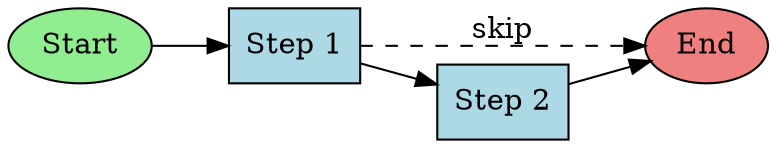

### Architecture with Subgraphs

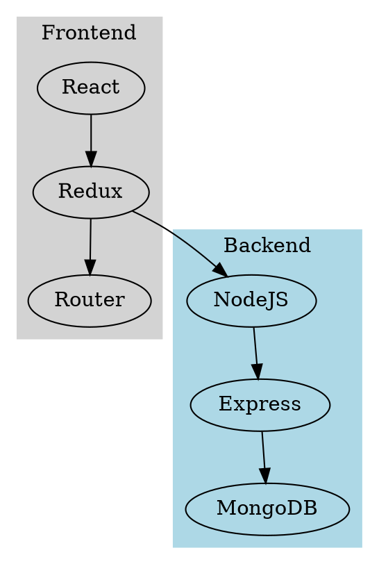

## LaTeX Math (KaTeX)

Inline: `$E = mc^2$`

Block:

```markdown
$$
E = mc^2
$$
```

Matrix:

```markdown
$$
\begin{pmatrix} a & b \\ c & d \end{pmatrix}
$$
```

## Choosing an Engine

| Need | Recommended engine |
|---|---|
| Flowchart / process diagram | Mermaid `flowchart` or PlantUML activity |
| Sequence / interaction diagram | Mermaid `sequenceDiagram` or PlantUML sequence |
| Data charts (bar, line, scatter) | Vega-Lite |
| Complex UML (class, deployment, use case) | PlantUML |
| Network topology / graph theory | Graphviz DOT |
| Gantt / project timeline | Mermaid `gantt` |
| State machine | Mermaid `stateDiagram-v2` or PlantUML state |
| Architecture / cloud topology | Mermaid `architecture-beta` |
| Priority matrix / quadrant | Mermaid `quadrantChart` |
| User journey | Mermaid `journey` |
| Mindmap | Mermaid `mindmap` |

## Local Assets for Offline HTML Reports

This skill does not bundle Mermaid or KaTeX runtimes. Do not generate links to imaginary `assets/scripts/` files or use a CDN as a hidden runtime dependency.

- For a self-contained report, render a diagram to inline SVG or build the diagram directly as SVG after the content and relations are settled. For equations, use readable text or an inline SVG produced by an available local renderer.
- If the owning project supplies an actual local Mermaid/KaTeX runtime, copy only the required files (including KaTeX fonts and auto-render support when used) into the dedicated preview bundle. Reference those verified files from the HTML; do not assume a skill-relative path is served.
- Open the final offline HTML in the declared target environment. Confirm that each diagram/equation is visible and that no local asset request fails. A source code block or a successful file export is not a rendered diagram.
- If neither static rendering nor a local runtime is available, keep the source notation and explain the rendering limitation instead of delivering a broken diagram.

## Export via docu.md

When the reader needs DOCX/PDF (not just HTML):

1. Agent produces `.md` source layer with diagram code blocks.
2. User opens `.md` in docu.md (browser extension / Obsidian / VS Code).
3. One-click export to DOCX (editable equations), PDF (print-ready), or HTML (self-contained).
4. Diagrams exported as high-resolution images.
5. LaTeX exported as editable Word equations in DOCX.

Platforms: Chrome, Edge, Firefox, Obsidian, VS Code, Mobile (iOS/Android). All processing is local; documents never leave the device.

## Boundaries

- docu.md is a rendering/export tool, not a methodology. It does not replace Cold-Start Gate, judgment-first ordering, or cognitive-entropy rules.
- A beautifully rendered report that fails the first-screen check is still a failure.
- XiaoLab-facing output must follow the current project visual contract owned by `kongyu-surface`; do not let docu.md's default theme silently replace it.
- The `.md` source layer is authoritative. docu.md output is derived.

## Functional Diagram Prompting

When generating images for reports, the prompt must specify concrete diagram elements, not abstract concepts. Name the components, connections, data flow direction, boundary labels, steps, decision branches, and terminal states. Do NOT generate abstract unlabeled or decorative images (rings, orbs, gradients) and present them as functional diagrams. If the image model cannot produce a labeled diagram, use Mermaid or SVG instead. karma #184.
